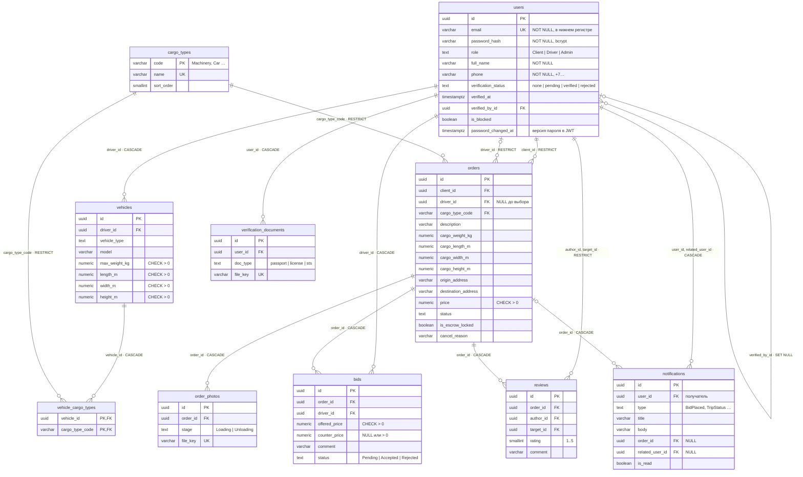

# База данных Dock (кейс 3)

PostgreSQL 17 (контейнер Docker, `docker-compose.yml`). Схема создаётся **только миграциями** (`server/src/database/migrations`) — ни одной таблицы
вручную. ORM-модели описаны в `server/src/models`; тест `01-database.test.ts` проверяет, что после миграций
схема в БД полностью совпадает с моделями.

## ER-диаграмма

**10 таблиц.** Связи 1:N: пользователь → ТС, заказчик → заявки, заявка → отклики / фото / отзывы, пользователь →
документы, пользователь → уведомления. Связь **N:M** «ТС ↔ типы грузов» — через промежуточную таблицу `vehicle_cargo_types` с составным
первичным ключом. `bids` — тоже связь заявок и водителей «многие ко многим», но с собственными атрибутами
(цена, встречная цена заказчика, комментарий, статус), поэтому это отдельная сущность с суррогатным ключом.

## Ограничения целостности

У каждой таблицы — первичный ключ (`uuid` с `gen_random_uuid()`, у справочника — неизменяемый код),
у всех обязательных столбцов — `NOT NULL`, даты — `timestamptz` с `default now()`.

| Ограничение | Таблица | Что запрещает |
|---|---|---|
| `uk_users_email` UNIQUE | users | два аккаунта на один email (проверяется ещё и сервисом → 409) |
| `ck_users_email_format`, `ck_users_phone_format`, `ck_users_full_name` | users | email не в нижнем регистре / без «@», телефон не в виде «+7» и 10 цифр, пустое имя |
| `users_role_check`, `users_verification_status_check` | users | роли и статусы вне списка |
| `ck_users_verification_driver_only` | users | статус проверки документов у заказчика или администратора |
| `ck_vehicles_max_weight`, `ck_vehicles_dimensions` | vehicles | нулевые, отрицательные и нереальные габариты |
| PK (`vehicle_id`, `cargo_type_code`) | vehicle_cargo_types | один тип груза у ТС дважды |
| `ck_orders_cargo_dimensions`, `ck_orders_price_positive`, `ck_orders_addresses` | orders | груз без габаритов, цена ≤ 0, пустые адреса |
| `ck_orders_driver_by_status` | orders | заявка «в работе» без водителя или открытая заявка с водителем |
| `ck_orders_escrow_by_status` | orders | рейс без оплаты; «замороженные» деньги у завершённого заказа |
| `ck_orders_cancel_reason` | orders | причина отмены у неотменённой заявки |
| `uk_bids_order_driver` UNIQUE | bids | второй отклик того же водителя на ту же заявку |
| `uk_bids_one_accepted` (частичный UNIQUE `where status = 'Accepted'`) | bids | два принятых отклика на одну заявку |
| `ck_bids_price_positive` | bids | цена ≤ 0 |
| `ck_bids_counter_price_positive` | bids | встречная цена ≤ 0 (NULL — встречной цены нет) |
| `notifications_type_check` | notifications | тип уведомления вне списка |
| `uk_order_photos_file_key`, `uk_verification_documents_file_key` | фото, документы | две записи на один файл |
| `uk_verification_documents_user_type` | verification_documents | два паспорта у одного водителя |
| `uk_reviews_order_author` UNIQUE | reviews | второй отзыв от той же стороны по тому же заказу |
| `ck_reviews_rating_range`, `ck_reviews_not_self` | reviews | оценка вне 1–5, отзыв самому себе |

Сервисы проверяют те же правила раньше (понятное сообщение и код 403/409/422), а ограничения БД — последний рубеж:
некорректные данные нельзя записать даже прямым SQL. Тест `01-database.test.ts` пытается сделать это напрямую
и получает исключения CHECK / UNIQUE / FOREIGN KEY.

## Правила удаления связанных данных

| Внешний ключ | Правило | Почему |
|---|---|---|
| `vehicles.driver_id` → users | **CASCADE** | ТС без владельца не имеет смысла |
| `vehicle_cargo_types.vehicle_id` → vehicles | **CASCADE** | строки связи принадлежат ТС |
| `vehicle_cargo_types.cargo_type_code` → cargo_types | **RESTRICT** | нельзя удалить тип груза, который кто-то возит |
| `orders.client_id`, `orders.driver_id` → users | **RESTRICT** | заявки — история сделок и расчётов; пользователей с историей не удаляют, а блокируют (`is_blocked`) |
| `orders.cargo_type_code` → cargo_types | **RESTRICT** | справочное значение используется в заявках |
| `bids.order_id`, `order_photos.order_id`, `reviews.order_id` → orders | **CASCADE** | отклики, фото и отзывы — части заявки (композиция в SAD); заявку без откликов можно удалить |
| `bids.driver_id` → users | **CASCADE** | отклик без водителя не имеет смысла; назначенного водителя защищает RESTRICT в orders |
| `reviews.author_id`, `reviews.target_id` → users | **RESTRICT** | отзывы формируют рейтинг, их нельзя терять незаметно |
| `verification_documents.user_id` → users | **CASCADE** | персональные данные удаляются вместе с аккаунтом |
| `users.verified_by_id` → users | **SET NULL** | если аккаунт администратора удалят, решение о проверке сохранится, но без автора |
| `notifications.user_id` → users | **CASCADE** | уведомления — часть аккаунта получателя |
| `notifications.order_id` → orders | **CASCADE** | уведомление об удалённой заявке теряет смысл (удалить можно только заявку без откликов) |
| `notifications.related_user_id` → users | **CASCADE** | уведомление администратору о пользователе, которого больше нет, не нужно |

## Нормализация

- **1НФ:** все значения атомарны; список перевозимых грузов ТС вынесен в отдельную таблицу `vehicle_cargo_types`
  вместо массива или строки через запятую.
- **2НФ:** в таблице с составным ключом (`vehicle_cargo_types`) нет неключевых атрибутов.
- **3НФ:** название типа груза хранится один раз в `cargo_types`, заявки ссылаются на код. Габариты груза
  хранятся в заявке, а не копируются в отклики. Кто загрузил фото, не хранится: это всегда назначенный водитель
  (`orders.driver_id`). Рейтинг не хранится в `users` — он вычисляется агрегатом по `reviews` и не может
  разойтись с отзывами.
- **Осознанное решение:** `reviews.target_id` формально выводится из заказа и автора, но хранится явно —
  иначе подсчёт рейтинга потребовал бы соединения с `orders` и условий по ролям; корректность значения проверяет
  сервис, а `ck_reviews_not_self` не даёт оценить себя.
- **Осознанное решение:** `notifications.title` и `body` хранят готовый текст, а не собираются из заказа при
  чтении: уведомление фиксирует событие на момент, когда оно произошло (цена отклика могла потом измениться).
- **Единицы измерения:** масса — килограммы, габариты — метры (`numeric` без потери точности); тонны показывает
  только интерфейс.

## Индексы — под конкретные запросы

| Индекс | Запрос, который он ускоряет |
|---|---|
| `idx_orders_client_created (client_id, created_at desc)` | «Мои заявки»: `where client_id = ? order by created_at desc limit … offset …` |
| `idx_orders_driver_updated (driver_id, updated_at desc) where driver_id is not null` | «Мои рейсы» водителя; заявки без водителя в индекс не попадают |
| `idx_orders_open_created (created_at desc) where status in ('Created','Bidding')` | лента водителя — только открытые заявки |
| `idx_orders_search_trgm` GIN (`pg_trgm`) по `description ‖ адреса` | поиск `ilike '%…%'` по тексту заявки |
| `idx_bids_driver_created (driver_id, created_at desc)` | «Мои отклики» водителя |
| `uk_bids_order_driver (order_id, driver_id)` | отклики заявки (`where order_id in (…)`) — первый столбец уникального индекса |
| `idx_vehicles_driver`, `idx_order_photos_order` | ТС водителя, фото заявки (соединения по внешним ключам) |
| `idx_reviews_target` | рейтинг: `avg(rating) … where target_id in (…) group by target_id` |
| `idx_users_verification_pending (updated_at) where verification_status = 'pending'` | очередь модерации администратора |
| `idx_notifications_user_created (user_id, created_at desc)` | список уведомлений: `where user_id = ? order by created_at desc limit … offset …` |
| `idx_notifications_user_unread (user_id) where not is_read` | счётчик на колокольчике: `count(*) where user_id = ? and not is_read`; прочитанные строки в индекс не попадают |

Не индексируются: `orders.cargo_type_code` (6 значений, низкая селективность — фильтр применяется поверх индекса
открытых заявок), `vehicle_cargo_types.cargo_type_code` (обратный поиск «какие ТС возят тип X» не используется),
логические флаги. Первичные ключи и UNIQUE индексируются PostgreSQL автоматически.

## Миграции (аналог Alembic)

| Файл | Что делает |
|---|---|
| `Migration20261028100000_initial_schema.ts` | Начальная схема: 8 таблиц, ограничения, индексы, справочник типов груза |
| `Migration20261028110000_verification_and_search.ts` | **Изменение существующей схемы**: флаг `is_verified` заменён статусом `verification_status` (+ `verified_at`, `verified_by_id`) **с переносом данных**, новая таблица `verification_documents`, расширение `pg_trgm` и GIN-индекс поиска |
| `Migration20261029100000_notifications_and_bargaining.ts` | Таблица `notifications` с индексами, столбец `bids.counter_price` (встречная цена заказчика) с CHECK, столбец `users.password_changed_at` (после смены пароля прежние токены не принимаются) |
| `Migration20261029120000_phone_format.ts` | **Изменение с переносом данных**: телефоны, сохранённые как ввели (`89161234567`, `9161234567`), приводятся к виду `+79161234567`; `ck_users_phone_format` ужесточён до «+7 и 10 цифр» |

Команды (в папке `server`): `npm run db:migrate` (≈ `alembic upgrade head`), `npm run db:migrate:down`
(≈ `alembic downgrade -1`), `npm run db:status` (≈ `alembic current/history`). Применённые миграции хранятся
в таблице `mikro_orm_migrations`; каждая миграция и весь прогон — в транзакции (при ошибке всё откатывается).
У всех четырёх миграций есть `down()`: тест откатывает схему до пустой и накатывает снова.

## Начальные данные

`npm run db:seed` (`server/src/database/seed.ts`) создаёт через ORM в одной транзакции: 7 пользователей всех ролей
и состояний (проверен / на проверке / без проверки / заблокирован), 4 ТС с разными типами грузов, 12 заявок во
всех статусах (для фильтров, поиска, сортировки и пагинации), отклики (один — со встречной ценой заказчика), фото,
взаимные отзывы, документы и 11 уведомлений о событиях из этих же данных (отклики, встречная цена, выбор
исполнителя, оплата, этапы рейса, приёмка, отзывы, документы на проверку).
Этого достаточно для ошибочных сценариев: отклик без проверки (403), чужая заявка (403), повторный отклик (409),
отмена оплаченного заказа (409), вход заблокированного (403).
